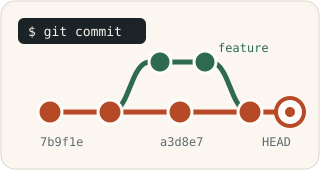

> [!NOTE]
> The English translation for this exercise can be found in [this file](./readme.en.md).

# Git "Hello world"



Tässä tehtävässä opit Git-versionhallinnan perusasiat. Tehtävän edellytyksenä on, että olet [asentanut Git-työkalun koneellesi (git-scm.com)](https://git-scm.com/) ja tehnyt [tarvittavat asetukset Gitin käyttämiseksi (GitHub)](https://docs.github.com/en/get-started/quickstart/set-up-git). Tarvitset myös [GitHub](https://github.com/)-tunnuksen, jonka voit luoda osoitteessa https://github.com/.

🔐 *Jos käytät GitHubia jo työsi puolesta, voi olla tietoturvasyistä kannattavaa luoda erillinen tunnus opintoja varten. Omaa nimeäsi ei tarvitse antaa rekisteröitymisessä. Sähköpostiosoitteena voit käyttää oppilaitoksen sähköpostia ja piilottaa sen muilta käyttäjiltä [GitHubin ohjeiden](https://docs.github.com/en/account-and-profile/setting-up-and-managing-your-personal-account-on-github/managing-email-preferences/setting-your-commit-email-address#setting-your-commit-email-address-on-github) mukaisesti.*

⛔ *Jos et missään tapauksessa halua käyttää kurssilla GitHubia, sovi opettajasi kanssa vaihtoehtoisesta git-palvelusta.*

**Tämän luvun suorittaminen.** Tämä luku tehdään omalla koneellasi ja GitHubissa. Kurssijärjestelmään (https://jtjuslin.kapsi.fi/java) ei palauteta mitään, eikä luvusta saa pisteitä. Kurssin muut luvut palautetaan kurssijärjestelmään, ja niiden tehtäväpohjat ovat samassa GitHub-organisaatiossa: https://github.com/o2-syksy2026. Niissä täydet pisteet saa, kun testit menevät läpi myös **julkisesta** GitHub-repositoriostasi haetulle koodille. Repositorio saa jäädä julkiseksi. Ohjeet ovat kunkin luvun kohdassa "Palauttaminen ja pisteet".


## Git-komentorivityökalu

Tehtävänanto keskittyy Git-komentorivityökaluun, ja oletamme [komentorivin peruskäytön](https://developer.mozilla.org/en-US/docs/Learn/Tools_and_testing/Understanding_client-side_tools/Command_line), kuten komentorivin avaamisen ja hakemistojen välillä siirtymisen, olevan tuttua. Voit ratkaista tämän ja seuraavat tehtävät myös graafisella työkalulla, kuten VS Codella tai GitHub Desktopilla, mutta joudut silloin etsimään vastaavat toiminnot itsenäisesti.

* [Command line crash course (developer.mozilla.org)](https://developer.mozilla.org/en-US/docs/Learn/Tools_and_testing/Understanding_client-side_tools/Command_line)
* [Using Git source control in VS Code (code.visualstudio.com)](https://code.visualstudio.com/docs/sourcecontrol/overview)
* [GitHub Desktop (desktop.github.com)](https://desktop.github.com/)


## Gitin perusteet

Gitin käyttöön löytyy valtavasti ohjeita, joiden näkökulma vaihtelee: osassa luodaan oma repositorio, osassa kloonataan valmis, ja osassa käytetään kehityshaaroja. Tässä tehtävässä tarvitset vain komentoja `clone`, `add`, `commit` ja `push`, joten syventävät aiheet, kuten kehityshaarat (branch), voit jättää toistaiseksi väliin. Suosittelemme seuraavia lähteitä:

* [What is version control? (Atlassian)](https://www.atlassian.com/git/tutorials/what-is-version-control). Katso myös [video](https://youtu.be/xQujH0ElTUg).
* [What is Git (Atlassian)](https://www.atlassian.com/git/tutorials/what-is-git)
* [Install Git (Atlassian)](https://www.atlassian.com/git/tutorials/install-git)
* [Git add (Atlassian)](https://www.atlassian.com/git/tutorials/saving-changes)
* [Git Cheat Sheet, pdf (GitHub)](https://education.github.com/git-cheat-sheet-education.pdf)


## Tehtävä

Tehtävässä forkkaat tämän repositorion itsellesi, kloonaat sen koneellesi, teet siihen pienen muutoksen ja viet muutoksen takaisin GitHubiin.

### Repositorion forkkaaminen ja kloonaaminen

Forkkaa ensin tämä repositorio omaan GitHub-repositorioosi GitHubin **Fork**-painikkeella ja kloonaa vasta sitten oma forkkisi koneellesi:

```sh
git clone https://github.com/<oma-github-tunnuksesi>/1-git-hello-world.git
```

Avaa kloonattu hakemisto koodieditorissasi. Tämä repositorio ei sisällä Java-projektia vaan yksittäisen tekstitiedoston, joten se näyttää editorissa erilaiselta kuin "tavalliset" projektit.

💡 *Git kloonaa repositorion alihakemistoon, jonka nimi on oletuksena sama kuin repositorion nimi. Seuraavat komennot annetaan tämän hakemiston sisällä, joten [siirry siihen komentorivillä](https://en.wikipedia.org/wiki/Cd_(command)).*

### Tiedoston muokkaaminen

Avaa tiedosto [hello.txt](./hello.txt) koodieditorillasi, lisää siihen teksti `hello world` ja tallenna tiedosto. Anna komento `git status` ja tarkastele sen tulostetta. Näkyykö `hello.txt` tulosteessa? Mitä siitä kerrotaan?

### Muutoksen lisääminen

Muutos lisätään versionhallintaan kahdessa vaiheessa, jotka on kuvattu dokumentissa [Git add (Atlassian)](https://www.atlassian.com/git/tutorials/saving-changes). `git status` kertoo, että tiedosto on muuttunut, ja näyttää vinkin komennosta, jolla muutos lisätään:

```sh
git status
git *** hello.txt    # korvaa *** status-komennon antamalla komennolla
```

Yhteen commitiin voi lisätä useita tiedostoja, mutta tällä kertaa riittää tämä yksi.

### Commitin luonti

`git status` näyttää nyt, mitkä tiedostot ovat valmiina commitoitavaksi:

```
Changes to be committed:
  (use "git restore --staged <file>..." to unstage)
        modified:   hello.txt
```

Luo uusi commit, jossa muutos on mukana:

```sh
git commit -m "Hello world lisätty tiedostoon"   # korvaa viesti vapaasti valitsemallasi tekstillä
```

💡 *`-m` tarkoittaa viestiä (commit **m**essage), jolla muutos tunnistetaan myöhemmin versiohistoriassa.*

### Commitin vienti etärepositorioon

Anna taas komento `git status`. Git kertoo, että paikallinen kopiosi on yhden commitin edellä etärepositoriota:

```
On branch master
Your branch is ahead of 'origin/master' by 1 commit.
  (use "git ****" to publish your local commits)
```

Julkaise muutoksesi etärepositorioon Gitin antaman ohjeen mukaisesti:

```sh
git ****    # korvaa **** edellisestä komennosta saamallasi komennolla
```

Tarkista lopuksi GitHubista, että `hello.txt` on päivittynyt forkissasi.


## .gitignore ja .gitattributes

Tehtäväpohjassa on lisäksi pisteellä alkavia "piilotiedostoja". Jos ne eivät näy editorissasi, voit joutua muuttamaan editorin asetuksia. [.gitignore](./.gitignore)-tiedostossa määritellään, mitkä tiedostot jätetään [versionhallinnan ulkopuolelle](https://git-scm.com/docs/gitignore), ja [.gitattributes](./.gitattributes)-tiedostossa määritetään tekstitiedostoille [yhtenäiset rivinvaihtomerkit](https://docs.github.com/en/get-started/getting-started-with-git/configuring-git-to-handle-line-endings). Voit muokata näitä tiedostoja tarpeen mukaan.


## Lisenssi ja tekijät

Tämän tehtävän ovat kehittäneet Teemu Havulinna ja Jukka Juslin, ja se on lisensoitu [Creative Commons BY-NC-SA -lisenssillä](https://creativecommons.org/licenses/by-nc-sa/4.0/). Tehtävänannon, lähdekoodien ja testien toteutuksessa on hyödynnetty ChatGPT 3.5 -kielimallia sekä GitHub Copilot -tekoälyavustinta.
